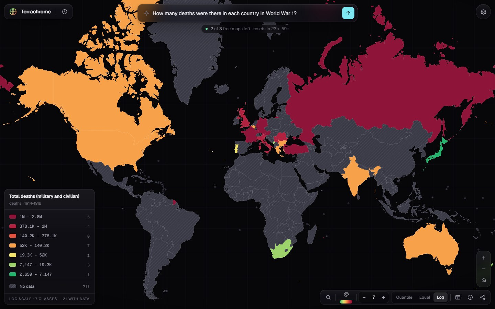

# Terrachrome

Ask a question about the world, and get an interactive map.

> *"How many deaths were there in each country in World War 1?"* · *"Average annual rainfall by country"* ·
> *"Nuclear warheads by country"*

One AI call returns a value for every country it can defend. The backend validates the result, fills in
"no data", and bins it, and a dark, glassy MapLibre map colours it in. Common statistics (21 World Bank
indicators, such as population, rainfall, GDP per capita and life expectancy) come straight from the
World Bank at no cost. Repeat questions come from a cache.



* **No login to start.** 3 free maps per rolling 24 hours. Cached maps, World Bank maps, palette and
  binning changes don't use them.
* **Sign in with Google, then add your own OpenAI or Anthropic API key** for unlimited maps, plus web
  search for recent statistics. OpenAI is the default; Anthropic is one click away. The key stays in your
  browser and is never stored on the server.
* **Honest by design.** Countries without a defensible value are left blank rather than guessed. Every
  value carries a confidence level, and notes explain historical states (e.g. "Russian Empire").
  Each map says *AI-generated estimates, verify before citing*.

## Quick start

You need **Python 3.12+**, **Node.js 20+** and **git**.

```bash
git clone <this-repo-url> terrachrome && cd terrachrome
```

```bash
make dev
```

Then open **http://localhost:5173**. No make? Run `python scripts/dev.py` instead; every make target is a
`scripts/dev.py` command.

The first run takes about a minute: it creates `.env` with a random `SESSION_SECRET`, `backend/.venv`, and
`frontend/node_modules`. The defaults are **`LLM_MODE=mock`** (fixture answers, no API key, no cost) and
**`AUTH_MODE=mock`** (a fake local Google account), so the whole product works with no external setup.
To see the full flow, ask three questions; the fourth opens the free-limit prompt. (World Bank questions
such as population, and repeated questions, are free and don't count.) "Continue with Google" signs you
in as a mock user. Then any made-up key in the right shape unlocks unlimited maps: for OpenAI (the
default), `sk-proj-` followed by 20 or more letters, digits or dashes; for Anthropic, `sk-ant-` followed
by the same. Mock mode checks only the shape, and a key containing `invalid` simulates a rejected key.

| Command | What it does |
|---|---|
| `make dev` | Run the API (:8000) and the web app (:5173) with hot reload; installs what's missing first |
| `make test` | Backend tests (pytest, 179) and frontend tests (vitest, 23) |
| `make screenshots` | Visual verification: drives the app in Chrome and writes 43 screenshots to `docs/screenshots/` |
| `make bench` | Retrieval benchmark against the real APIs (needs `OPENAI_API_KEY` and/or `ANTHROPIC_API_KEY`; capped at $1) |
| `make build` / `make start` | Production build; the API then serves the app on :8000 |
| `make setup` / `make clean` / `make data` | Install / remove dependencies / rebuild the country dataset |

> OneDrive, Dropbox and similar folders work, but syncing `node_modules` and `.venv` is slow. Consider
> cloning outside a synced folder.

## Going live

### Real AI answers

Edit `.env`:

```dotenv
LLM_MODE=live
LLM_PROVIDER=openai            # who pays for free-tier maps: openai (default) or anthropic
OPENAI_API_KEY=sk-proj-...     # the server key; leave empty to allow only own-key maps
DAILY_BUDGET_USD=1.00          # free tier pauses (with a friendly message) once today's spend reaches this
```

For Anthropic instead, set `LLM_PROVIDER=anthropic` and `ANTHROPIC_API_KEY=sk-ant-...`. Either way,
signed-in users can bring a key for either provider.

The default models are `gpt-6-luna` (OpenAI's cheapest current model) and `claude-haiku-5-5` (Anthropic's).
They have the same list prices: a full 200-country map costs roughly $0.001. See
[docs/RETRIEVAL_BENCHMARK.md](docs/RETRIEVAL_BENCHMARK.md). Run `make bench` once with your keys to
replace the projected numbers there with measured ones. If a model misses the accuracy bar, change
`OPENAI_MODEL_ID` or `MODEL_ID` (for example `gpt-6.1-terra` or `claude-sonnet-5-5`). Per-model prices and
settings live in `backend/app/llm/profiles.py`, so no code changes are needed.

### Google sign-in

1. Open the [Google Cloud console](https://console.cloud.google.com/) and create (or pick) a project.
2. Open **Menu → Google Auth platform** (older consoles call it *APIs & Services → OAuth consent
   screen*) and click **Get started**:
   * **App information**: an app name and a user support email.
   * **Audience**: **External**.
   * **Contact information**: your email. Accept the user data policy, then click **Create**.

   While the app's publishing status is *Testing*, only test users can sign in: on the **Audience**
   page, add your Google account under **Test users**. The app asks only for `openid`, `email` and
   `profile`. Those are non-sensitive scopes, so you can list them under **Data Access** but Google
   doesn't need to verify the app.
3. Go to **Clients → Create client** and choose the application type **Web application**. Under
   **Authorized redirect URIs**, add:
   * `http://localhost:5173/api/auth/google/callback` for `make dev`
   * `http://localhost:8000/api/auth/google/callback` if you also try `make start`
   * `https://maps.example.com/api/auth/google/callback` in production

   The redirect URI must match exactly: scheme, host, port and path. In development the browser
   talks to Vite on :5173, which proxies `/api` to the backend, so the callback lives on :5173.
   *Authorized JavaScript origins* can stay empty, because sign-in is a server-side redirect flow.
   Click **Create**.
4. Copy the client ID and client secret into `.env`:

```dotenv
AUTH_MODE=google
GOOGLE_CLIENT_ID=1234567890-abc.apps.googleusercontent.com
GOOGLE_CLIENT_SECRET=GOCSPX-...
SESSION_SECRET=<a long random string>      # make dev generated one; the app refuses google mode without it
PUBLIC_BASE_URL=https://maps.example.com    # production only: builds the redirect URI behind a proxy
```

Sign-in uses the OpenID Connect authorization-code flow with PKCE (S256), `state` and `nonce`, through
[Authlib](https://docs.authlib.org/). The backend validates the ID token and keys accounts on Google's
`sub` claim. It stores only `sub`, name, email and photo URL. The button follows Google's branding
guidelines (dark theme, standard "G", Google Sans).

### Your own OpenAI or Anthropic key (BYOK)

Signed-in users can add a key under **Settings → API key** (or in the prompt that appears at the free
limit). The form preselects **OpenAI**; switch to **Anthropic** to use a Claude key instead. The key is
checked first: OpenAI keys by looking up the model (no tokens used), Anthropic keys with a 1-token call.
Then it is kept in the browser: in `localStorage` with "Remember on this device", otherwise in
`sessionStorage`. It is sent only on the user's own map requests, in the `X-OpenAI-Key` or
`X-Anthropic-Key` header, and that header decides which provider runs the map (`gpt-6-luna` or
`claude-haiku-5-5`). The server never stores or logs it; a redaction filter and tests for both key formats
enforce that. Own-key maps are unlimited, still bound by `MAX_OUTPUT_TOKENS` and per-minute rate limits, and may use
web search (`WEB_SEARCH_MAX_USES`) when the AI judges a question to be about recent data.

## How it works

```
Browser ──POST /api/maps (SSE)──▶ FastAPI
                                   ├─ checks: 200-char limit · sign-in for own keys · 1 request in flight · rate limits
                                   ├─ Tier 0  SQL cache on the normalized question ............ free, uncounted
                                   ├─ Tier C  World Bank connector (21 indicators) ............ free, uncounted
                                   ├─ free-tier quota (3 / rolling 24 h) + daily budget breaker
                                   ├─ Tier 1  one AI call (OpenAI by default, or Claude): strict JSON, cached prompt, no tools
                                   └─ Tier 2  own key: same call + web search (the model decides)
                                        │
                                        ▼  deterministic: validate ISO codes, coerce numbers, drop invalid,
                                           fill N/A, stats, quantile / equal / log bins (backend edges)
Browser ◀── status · progress (live country count) · result (bin indices + legend) ──┘
```

* **One LLM call per map**, covering every country. Rows are compact arrays (`["FRA", 1397800, "m"]`),
  because output tokens are about 90% of the cost.
* The system prompt (rules, successor table for historical states, examples, and the canonical country
  list generated from the same GeoJSON as the map) is cached: explicitly with `cache_control` on
  Anthropic, automatically (with a fixed `prompt_cache_key`) on OpenAI. The user's question
  arrives inside `<user_query>` tags and is treated as untrusted data.
* The server returns bin **indices**, not colours, so palette changes are instant. Re-binning
  (3-9 classes; quantile, equal or log) runs on stored values: no LLM call, no quota.
* Free-tier quota counts the browser cookie, a salted hash of the IP, and the signed-in account
  separately; any one at the limit blocks. Clearing cookies or signing in doesn't reset it. Raw IPs are
  never stored.

More: [PLAN.md](PLAN.md) · [docs/DECISIONS.md](docs/DECISIONS.md) (39 recorded decisions) ·
[docs/RETRIEVAL_BENCHMARK.md](docs/RETRIEVAL_BENCHMARK.md) · [docs/ACCEPTANCE.md](docs/ACCEPTANCE.md) ·
[data/README.md](data/README.md)

### API

| Endpoint | Purpose |
|---|---|
| `POST /api/maps` | `{query}` → server-sent events `status`, `progress`, then `result` or `error` |
| `GET /api/maps/{slug}` | A saved map (share links `/m/{slug}`) |
| `POST /api/maps/{slug}/rebin` | `{method, classes}` → new bins; no LLM, no quota |
| `GET /api/usage` | `{used, limit, remaining, reset_at, byok, signed_in, byok_available, budget_exhausted}` |
| `POST /api/key/validate` | Checks the key in `X-OpenAI-Key` or `X-Anthropic-Key` (sign-in required); the key is never stored |
| `GET /api/examples` · `GET /api/config` · `GET /api/health` | Starter questions · mode flags · liveness |
| `GET /api/auth/google/login` · `GET /api/auth/google/callback` · `POST /api/auth/logout` | Sign-in |
| `GET /api/me` · `DELETE /api/me` · `GET /api/me/export` | Profile · delete account and all its data · JSON export |
| `GET /api/history` · `DELETE /api/history` | History drawer · clear (doesn't reset the quota) |

Errors are always `{code, message, …}`: `quota_exceeded` (429, with `reset_at`), `rate_limited` (429),
`budget_exhausted` (503), `signin_required` (403), `in_flight` (409), `invalid_key`, `ambiguous_key` (400,
both key headers sent), and others.
Mutating calls must send `X-Requested-With` (CSRF defense in depth).

## Configuration

Everything is in [`.env.example`](.env.example), with a comment per setting. The most important:

| Variable | Default | Notes |
|---|---|---|
| `LLM_MODE` / `AUTH_MODE` | `mock` / `mock` | `live` / `google` for real use |
| `LLM_PROVIDER` | `openai` | who pays for free-tier maps: `openai` or `anthropic` (users' own keys can be either) |
| `OPENAI_API_KEY` / `ANTHROPIC_API_KEY` | empty | server keys for free-tier maps in live mode |
| `OPENAI_MODEL_ID` | `gpt-6-luna` | gpt-6-luna, gpt-6.1-terra and gpt-6.1-sol have built-in price profiles |
| `MODEL_ID` | `claude-haiku-5-5` | the Anthropic model; Haiku, Sonnet and Opus 5.5 have price profiles; unknown ids of either provider are costed at Sonnet rates |
| `MAX_OUTPUT_TOKENS` | `4000` | hard cap per map |
| `FREE_MAPS_PER_DAY` / `FREE_MAPS_PER_IP_PER_DAY` | `3` / `3` | raise the per-IP value for shared networks (campuses) |
| `DAILY_BUDGET_USD` | `1.00` | free-tier spend per UTC day; `0` disables free LLM maps |
| `RATE_LIMIT_PER_MINUTE` / `MAPS_RATE_LIMIT_PER_MINUTE` | `60` / `8` | per IP hash |
| `DATASOURCES_ENABLED` | `true` | World Bank tier |
| `DATABASE_URL` | SQLite in `backend/var/` | e.g. `postgresql+psycopg://…` after `pip install "psycopg[binary]"` |
| `TRUST_PROXY_HEADERS` / `TRUSTED_PROXY_HOPS` | `false` / `1` | only behind a proxy you control |

## Production

```bash
make start
```

This builds the frontend, then runs one uvicorn process on http://localhost:8000 that serves the API and
the app from the same origin. On a server, put it behind a reverse proxy that terminates TLS (Caddy,
nginx). Cookies are always `Secure`, so the site must use HTTPS (browsers exempt only localhost). Then set:

* `TRUST_PROXY_HEADERS=true` and `TRUSTED_PROXY_HOPS` (how many proxies you run), so per-IP limits see
  the real client address;
* `PUBLIC_BASE_URL=https://maps.example.com`, so the OAuth redirect URI uses your public address;
* a real `SESSION_SECRET` (32+ characters) and, optionally, `IP_HASH_SALT`;
* `DATABASE_URL`, if you want Postgres.

The API adds Open Graph tags to `/m/{slug}` share links, gzips JSON and static files (never the event
stream), and sends a strict Content-Security-Policy. **Run a single worker process:** per-minute limits
and the in-flight lock live in memory.

## Testing

* `make test`: **179 backend tests** cover schema validation, ISO filtering, N/A fill, binning (quantile,
  equal, log, all-equal, single value, outliers, tied values), the rolling-window limiter, cookie-clearing
  bypass, no quota for cache hits or errors, cache normalization, rebinning, mock and stubbed-Google login,
  cookie flags, anonymous-to-account claim, quota surviving sign-in, the 403 for keys without a session,
  account deletion, and the BYOK key never reaching logs, responses or the database. They also cover
  both providers: the OpenAI client against a scripted Responses stream (request shape, usage and cost,
  truncation, refusals, web search and its fallback, error mapping), routing by key header, and
  redaction of OpenAI key formats. **23 frontend tests** cover palettes, formatting, the SSE parser, key
  storage (with the provider) and CSV injection.
* `make screenshots`: a Playwright run against isolated servers, using your installed Chrome or Edge.
  It walks every state (empty, loading, map, tooltip, legend hover, details, palettes, rebinning, info,
  table, share and export, history, all Settings tabs, unmappable, both Access modal steps, sign-in,
  key save and resume, reload, share link, every error state, tablet and phone). It fails on console errors.
  To check everything without rewriting the committed screenshots, run
  `node e2e/screenshots.mjs --out=<some folder>` from `frontend/`.
* `make bench`: see [docs/RETRIEVAL_BENCHMARK.md](docs/RETRIEVAL_BENCHMARK.md).

## Known limitations

* **Unmeasured AI accuracy and cost.** The retrieval benchmark's A/B strategies need API keys that weren't
  available while building, so the accuracy and per-map cost of gpt-6-luna and Haiku 5.5 are projections
  until `make bench` runs. Neither provider's live API was called from this build: both clients are tested
  against scripted SDK streams.
* **OpenAI web search with structured output** isn't documented by OpenAI. If the API rejects the
  combination, own-key OpenAI maps quietly fall back to a call without search (DECISIONS D-39).
* **OpenAI key checks** look the model up without generating tokens, so a key with no credit passes the
  check and fails on its first map with a clear "no remaining credit" message.
* **Knowledge cutoff.** Free-tier answers come from model knowledge, so recent figures can be stale.
  Own-key maps can search the web. Recency-sensitive maps are cached for 24 h instead of 30 days.
* **Countries only, numbers only.** No sub-national regions or cities. Categorical questions ("official
  language") are declined with numeric suggestions.
* **Historical states** map to their principal successor (USSR → Russia, Austria-Hungary → Austria), with
  a note. Splitting a historical figure across modern successors isn't attempted.
* **Single process.** Rate limits and the in-flight lock are in memory. SQLite is the tested database;
  Postgres is supported through SQLAlchemy but wasn't exercised here.
* **Shared IPs.** People behind one NAT share the per-IP free allowance unless `FREE_MAPS_PER_IP_PER_DAY`
  is raised.
* **Account deletion** also deletes that account's usage rows, as specified, which frees its own 24-hour window.
* **Map projection.** Web Mercator exaggerates high latitudes (Greenland, Russia). Tiny territories are
  shown as dots. Phones open on a partial world view.
* **Google sign-in** was verified here only with Google's endpoints stubbed (PKCE, state, nonce, claim
  handling). Run it once against your OAuth client.

## v2 ideas

* **Semantic cache.** `find_cached()` already has a `semantic_lookup()` stub; embed normalized questions and
  reuse near-duplicates within a similarity threshold.
* **More dataset connectors.** Our World in Data, UN and IMF behind the existing `DataSource` interface,
  with an LLM-free matcher per catalog.
* **Categorical and diverging maps.** Category legends, qualitative palettes, and a diverging scheme
  around zero for signed metrics.
* **Encrypted server-side key storage** (opt-in, per account), so keys follow users across devices.
* **More sign-in providers:** Apple, GitHub, email magic links.
* Shared rate limiting (Redis) for multi-worker deployments; per-account usage dashboards.
* An equal-area or globe projection, sub-national boundaries, time sliders for year-by-year series, and
  citations per value from web search.
